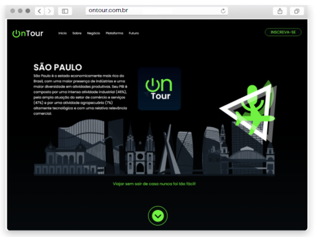
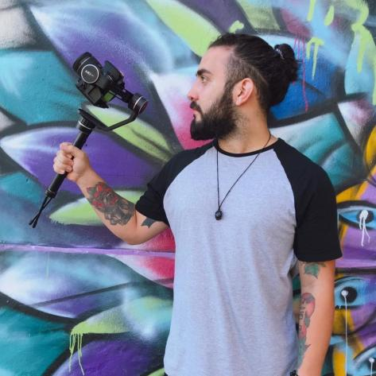

  

  
  
  
  

  <a href="https://rafaelfachinelli.github.io/OnTour/">Live demo</a>

  <a href="#eye_speech_bubble-preview">Preview</a> •
  <a href="#information_source-about">About</a> •
  <a href="#memo-tasks">Tasks</a> •
  <a href="#arrow_forward-run">Run</a> •
  <a href="#hammer_and_wrench-technologies">Technologies</a> •
  <a href="#muscle-contributors">Contributors</a> •
  <a href="#boy-author">Author</a> •
  <a href="#balance_scale-license">License</a>

---

## :eye_speech_bubble: Preview

|Desktop|Mobile|
|:---:|:---:|
|<kbd></kbd>|<kbd></kbd>|

|Scan to open|
|:---:|
||

---

## :information_source: About

🎴 Built at Inovathon 2020, São Paulo Tourism and Culture, where the team won **2nd place**. Museums, hotels and parks lost most of their visitors during the pandemic, and with them the income that keeps them running. OnTour is a platform for live online tours, free or paid, led by local guides with set routes and times. Institutions can publish their tours on their own websites, and enthusiasts can find them on the platform.

This repository has the responsive landing page that presents the idea.

---

## :memo: Tasks

Click to view

|State|Task|
|:---:|:---|
|:heavy_check_mark:|Responsive landing page|
|:heavy_check_mark:|Sections for museums, parks, places and companies|
|:heavy_check_mark:|Expandable cards|
|:heavy_check_mark:|Deploy on GitHub Pages|

---

## :arrow_forward: Run

No build step. Open `index.html` in a browser, or see the [live demo](https://rafaelfachinelli.github.io/OnTour/).

---

## :hammer_and_wrench: Technologies

|Web|
|:---:|
|[HTML5](https://developer.mozilla.org/en-US/docs/Web/HTML)|
|[CSS3](https://developer.mozilla.org/en-US/docs/Web/CSS)|
|[JavaScript](https://developer.mozilla.org/en-US/docs/Web/JavaScript)|

---

## :muscle: Contributors

<table>
  <tr>
    <td align="center">
      <a href="https://www.instagram.com/producoesgarcia_/">
        
         
        <b>Deivid Garcia</b>
      </a>
    </td>
    <td align="center">
      <a href="https://github.com/gfrancodev">
        
         
        <b>Gustavo Franco</b>
      </a>
    </td>
    <td align="center">
      <a href="https://github.com/rafaelfachinelli">
        
         
        <b>Rafael Fachinelli</b>
      </a>
    </td>
    <td align="center">
      <a href="https://github.com/thainamonteiro">
        
         
        <b>Thainá Monteiro</b>
      </a>
    </td>
  </tr>
</table>

---

## :boy: Author

<a href="https://rafaelfachinelli.com">
  
   
  <b>Rafael Fachinelli</b>
</a>

Tech Lead and software engineer. Get in touch!

---

## :balance_scale: License

This project is under the [MIT license](./LICENSE).
